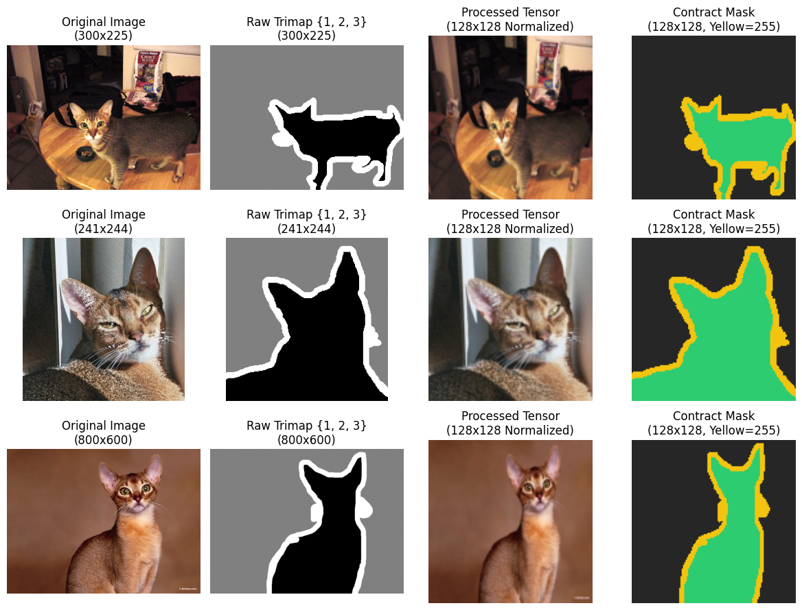
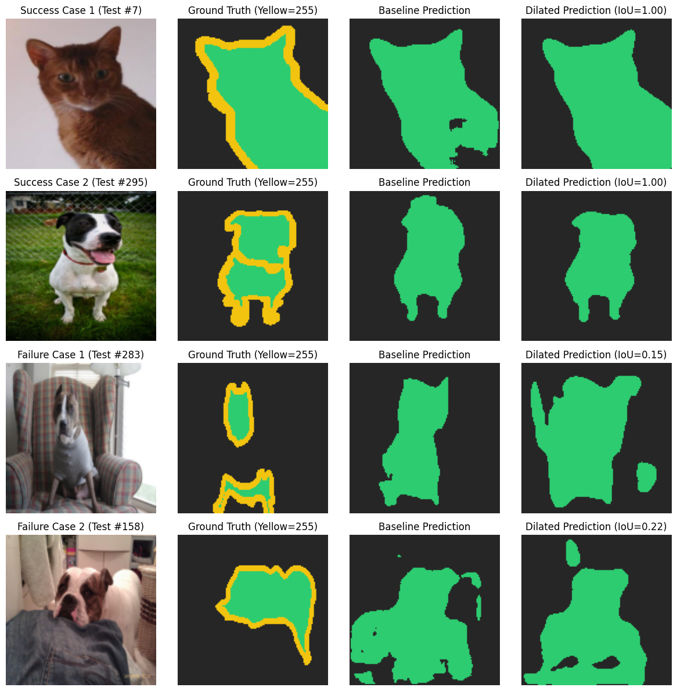

# CS107203CS Assignment B: Reproducible Semantic Segmentation Experiment (23115091)

**Comparative Study of Baseline U-Net and Dilated-Bottleneck U-Net for Pet Semantic Segmentation Using the Oxford-IIIT Pet Dataset**

---

## Submission Details
- **Name:** Shriyansh Pandey
- **Roll Number:** 23115091
- **Semester:** 7th Semester, B.Tech (Computer Science & Engineering)
- **Institution:** National Institute of Technology Raipur
- **Course:** Advanced Computer Vision (CS107203CS — Unit 3, Assignment B)
- **Submitted To:** Prof. Bunil Kumar Balabantaray (`bunil.balabantaray@gmail.com`)

---

## 1. Overview & Experimental Motivation
Dense semantic segmentation requires both fine-grained boundary localization and wide-area contextual reasoning. In a lightweight 3-stage U-Net operating on 128x128 inputs, two standard 3x3 convolutions in the 16x16 bottleneck only aggregate a 5x5 local receptive window (9.8% of the bottleneck feature map area), often causing false-negative holes inside large animal torsos.

This repository implements a strictly controlled, budget-matched experiment isolating the effect of **Dilated (Atrous) Convolutions** in the U-Net bottleneck:
- **Baseline U-Net (`use_dilation=False`):** Standard 3x3 bottleneck convolutions with dilation rates r = (1, 1) and padding p = (1, 1).
- **Controlled Change — Dilated U-Net (`use_dilation=True`):** Cascaded dilated 3x3 bottleneck convolutions with dilation rates r = (2, 4) and padding p = (2, 4), expanding the effective bottleneck receptive window from 5x5 to 13x13 (66.0% of the bottleneck feature map) with **zero additional trainable parameters**.

---

## 2. Task 1: Formal Data Contract (`OxfordPetSegContract`)
- **Dataset:** Official `torchvision.datasets.OxfordIIITPet` segmentation benchmark (7,349 total images).
- **Deterministic Splits (`SEED = 42`):**
  - **Training Split:** 2,944 images (80% of official `trainval`)
  - **Validation Split:** 736 images (20% of official `trainval`)
  - **Test Split:** 3,669 images (official held-out `test` split)
- **Spatial Transforms:** RGB images resized to 128x128 via Bilinear interpolation; segmentation trimaps resized to 128x128 via Nearest-Neighbour interpolation.
- **Synchronized Training Augmentation:** Random horizontal flip (p = 0.5) applied jointly to image and mask, plus random brightness jitter ([0.85, 1.15]).

| Raw Trimap Label | Contract Class ID | Semantic Region | Treatment in Loss & Confusion Matrix |
| :---: | :---: | :--- | :--- |
| `2` | `0` | Background (Indoor/Outdoor Scenery) | Evaluated in Cross-Entropy & IoU |
| `1` | `1` | Pet Foreground (Cat/Dog Body) | Evaluated in Cross-Entropy & IoU |
| `3` | `255` | Ambiguous Fur/Boundary Contour | Excluded (`ignore_index = 255`) |

---

## 3. Task 2 & Task 3: Controlled Architecture & Budget Specification

| Network Stage | Input Tensor | Output Tensor | Kernel & Operation | Trainable Params |
| :--- | :---: | :---: | :--- | :---: |
| `enc1` | 3x128x128 | 32x128x128 | 2x (Conv 3x3, r=1, p=1 + BN + ReLU) | 10,208 |
| `enc2` | 32x64x64 | 64x64x64 | MaxPool 2x2 -> 2x (Conv 3x3 + BN + ReLU) | 55,552 |
| `enc3` | 64x32x32 | 128x32x32 | MaxPool 2x2 -> 2x (Conv 3x3 + BN + ReLU) | 221,696 |
| `bottleneck` (Baseline) | 128x16x16 | 256x16x16 | MaxPool 2x2 -> Conv 3x3 (r=1, p=1) -> Conv 3x3 (r=1, p=1) | 885,760 |
| `bottleneck` (Dilated) | 128x16x16 | 256x16x16 | MaxPool 2x2 -> Conv 3x3 (r=2, p=2) -> Conv 3x3 (r=4, p=4) | 885,760 |
| `up3` + `dec3` | 256x16x16 | 128x32x32 | ConvTranspose 2x2 + Concat(enc3) -> ConvBlock(256->128) | 574,080 |
| `up2` + `dec2` | 128x32x32 | 64x64x64 | ConvTranspose 2x2 + Concat(enc2) -> ConvBlock(128->64) | 143,680 |
| `up1` + `dec1` | 64x64x64 | 32x128x128 | ConvTranspose 2x2 + Concat(enc1) -> ConvBlock(64->32) | 36,000 |
| `head` | 32x128x128 | 2x128x128 | Conv 1x1 (32->2, bias=True) | 66 |
| **Total** | — | — | **Identical Parameter Budget Across Both Models** | **1,927,042** |

- **Optimizer & Schedule:** AdamW (`lr = 1e-3`, `weight_decay = 1e-4`), Batch Size = `32`, Max Epochs = `12`, Early Stopping Patience = `4` (monitored on Validation mIoU).
- **Hardware & Environment:** Google Colab NVIDIA Tesla T4 GPU (`FP32`), Python `3.13.16`, PyTorch `2.14.1+cu130`, Torchvision `0.29.1+cu130`.

---

## 4. Task 4: Quantitative Results & Visual Evidence

### 4.1 Held-Out Test Split Performance (N = 3,669)

| Model Variant | Bottleneck Dilation | Trainable Params | Background IoU | Pet Foreground IoU | Mean IoU (mIoU) | T4 GPU Latency (Batch=1, FP32) |
| :--- | :---: | :---: | :---: | :---: | :---: | :---: |
| **Baseline U-Net** | r = (1, 1) | 1,927,042 | 91.61% | 83.98% | 87.80% | 2.12 ± 0.39 ms |
| **Dilated U-Net** | r = (2, 4) | 1,927,042 | **92.69%** | **86.42%** | **89.56%** | 2.14 ± 0.15 ms |
| **Net Improvement** | — | **0** | **+1.08%** | **+2.44%** | **+1.76%** | **+0.02 ms (Negligible)** |

### 4.2 Qualitative Success & Failure Mode Analysis
- **Success Cases (`Test #7`, `Test #295` — IoU = 1.00):** Expanding the bottleneck receptive window eliminates interior classification holes on shaded chest fur and cleanly resolves background gaps between limbs.
- **Failure Cases (`Test #283` IoU = 0.15, `Test #158` IoU = 0.22):**
  - In `Test #283`, the dog wears a grey sweater excluded from the ground-truth pet mask (leaving only the head and paws annotated as Class `1`), whereas both U-Net models segment the complete holistic animal body.
  - In `Test #158`, dark blanket folds beneath a bulldog share similar luminance and texture with the dog's coat, causing foreground boundary spillage.

### 4.3 Limitations: What This Experiment Does Not Establish
1. **Native-Resolution Hair Matting:** Because inputs are downsampled to 128x128 and the 3-pixel trimap border (`255`) is ignored, this study does not establish sub-pixel hair matting accuracy at megapixel resolution.
2. **Fine-Grained Multi-Class Scene Parsing:** Binary foreground/background evaluation does not establish whether (2, 4) bottleneck dilation improves 37-breed classification or dense multi-object urban/medical datasets.
3. **Edge CPU Latency Scaling:** Latency parity on an NVIDIA T4 GPU with parallel CUDA cores does not guarantee zero latency overhead on unaccelerated edge CPUs.

---

## 5. Repository Structure
- `23115091.ipynb`: Complete end-to-end Google Colab notebook (Tasks 1-4).
- `evaluate.py`: Standalone evaluation & latency benchmarking script.
- `environment_versions.json`: Logged Python, PyTorch, Torchvision, CUDA, and T4 GPU specs.
- `baseline_unet_training_log.json`: 12-epoch training/validation trajectory for Baseline U-Net.
- `dilated_unet_training_log.json`: 12-epoch training/validation trajectory for Dilated U-Net.
- `fig_preprocessing_samples.png`, `fig_training_curves.png`, `fig_bar_charts.png`, `qualitative_results.png`: Result visualizations.
